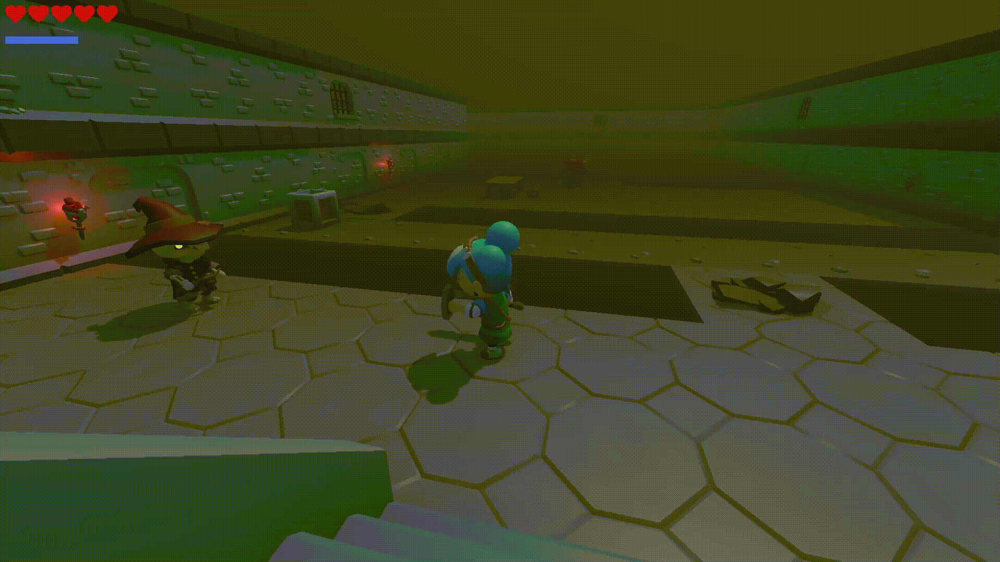
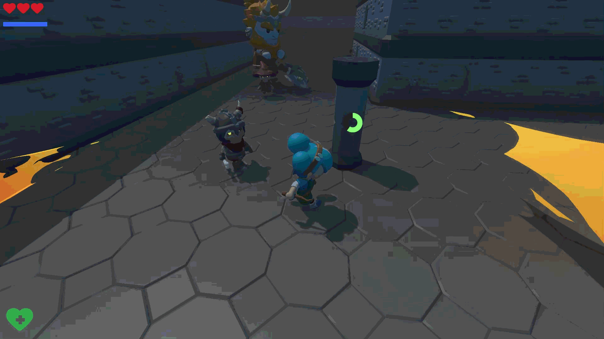

This project began as an unfinished game developed by following a YouTube tutorial. I expanded and improved upon the original work, transforming it into a short, standalone game.
 

 
 

 
 

 
 

<pre>

Source Video: https://www.youtube.com/watch?v=AoGOIiBo4Eg

Credits to  @ClearCode       (https://www.youtube.com/@ClearCode)

My Contributions:

Water Physics
Block Effect
Level Design
Improved Projectiles
Improved Enemy Behaviour
Improved Accessibility and UI

</pre>
